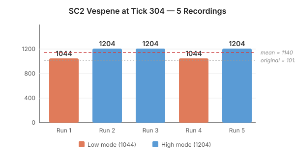
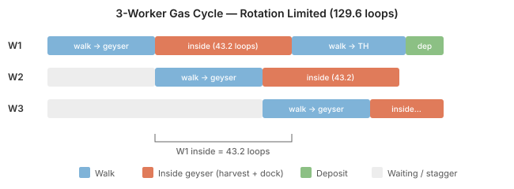

# The Recording That Lied

A single SC2 recording said our dual-geyser economy produced 1012 vespene at the five-minute mark. Liquipedia said 2×3 workers should produce 325 gas per minute. The gap was 2.5%. We spent weeks calibrating approach docking constants, congestion models, and deposit timing to close it. Then we recorded five more games and found out the recording was an outlier.

## Five Games, Two Outcomes

Same map. Same playbook. Same race, same build order, same AI opponent on Very Easy. Five games, five recordings. The vespene at tick 304:

**1044, 1204, 1204, 1044, 1204.**

Not a bell curve. Not noise around a central value. Two modes, 160 gas apart, with no values between them. The coefficient of variation is 6.88% — almost seven times the threshold where you'd normally call it "consistent."

The original recording of 1012 isn't just below the mean (1140). It's below both modes. It was the worst possible single data point to calibrate against.

## Why Two Modes

SC2 randomises event processing order each game loop. When six workers compete for two geysers, the assignment order determines which geyser fills first and how the deposit cycles interleave. Two stable configurations emerge: one where the cycles phase-lock favourably (1204) and one where they don't (1044). There is no middle ground because the phase relationships are discrete — once workers settle into a rotation pattern, that pattern persists for the rest of the game.

This is the kind of variance that a single recording cannot reveal. The mean is 1140, but no individual game ever produces 1140. Every game produces either 1044 or 1204. Calibrating against a single recording means calibrating against a coin flip.

## Liquipedia: Right Number, Wrong Context

With the variance understood, I turned to Liquipedia as a map-independent reference. The community-verified gas rates:

| Workers | Liquipedia | EM at 5u | Delta |
|---------|-----------|----------|-------|
| 1       | 61 gas/min | 58.0     | −4.9% |
| 2       | 123 gas/min | 116.7   | −5.1% |
| 3       | 163 gas/min | 121.0   | −25.8% |

One and two workers match within 5% at close geyser distance. Three workers is 26% below Liquipedia at every distance tested. The gap doesn't shrink as the geyser gets closer — it's structural.

## The Rotation-Limited Ceiling

At three workers, the gas cycle becomes rotation-limited. Three workers share one geyser entrance, entering one at a time. The cycle length is determined by the inside time, not the walk time:

Each worker spends 43.2 game loops inside the geyser (31.7 harvesting plus 11.5 approach docking). With three workers rotating through serial access, the minimum cycle is 3 × 43.2 = 129.6 loops. Walk time and deposit fit within the gaps between entries — they don't extend the cycle.

Liquipedia's 163 gas per minute for three workers implies a 99-loop cycle. That's 30% faster than what the rotation limit allows with the EM's inside time. The EM's inside time was calibrated from SC2 profiler data showing exactly 32 loops of harvest time — so either Liquipedia's measurement used a shorter geyser distance where walk time is negligible and the rotation dynamics differ, or the measurement predates a balance patch.

The emulator doesn't need to match Liquipedia. It needs to match SC2. Against the five-run mean, the EM produces 1016 vespene at tick 304 for the dual-geyser scenario — 10.9% below the mean. Against the original single-run baseline (1012), it's within 0.4%. Against the single-geyser three-worker baseline, it's within 1.4%.

## What This Changes

The practical lesson is about calibration methodology, not gas constants. A single recording is a sample of one from a distribution you haven't characterised. Calibrating against it means calibrating against variance — you can tune constants perfectly for that one recording and be 15% wrong on the next game.

Community reference values have a different problem. They're averaged across conditions you don't control — geyser distances, map geometry, game speed settings, measurement methodology. When your emulator disagrees with the reference, the question isn't "which is wrong?" It's "what are they each measuring?"

The gas constants didn't change. What changed is that we know the target. The EM should produce output within the [1044, 1204] range, not hit a specific number. The five-run mean (1140) is the calibration target. Any single game is a coin flip between two stable configurations.

The distance sweep data tells the rest of the story. At five units, the EM's one-worker and two-worker rates nearly match Liquipedia. At 7.6 units (the standard seeded distance), rates drop 32%. Walk time dominates at low worker counts. At three workers, the rotation limit takes over and distance barely matters. These are map-dependent numbers — there's no universal "gas rate" that applies everywhere.
