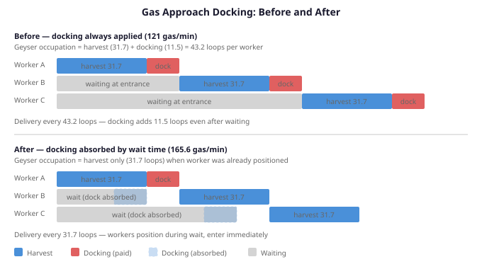

The emulated game's 3-worker gas rate was 121 gas/min. Liquipedia says 163. That's a 25.8% deficit — the kind of gap that makes you question whether the whole gas model is fundamentally wrong.

It wasn't. The physics was correct. The bug was in the bookkeeping.

## Paying the toll twice

SC2 geysers admit one worker at a time. With three workers assigned to one geyser, two are always waiting outside while one harvests inside. The emulator models this correctly — `MAX_INSIDE=1`, workers queue at the entrance.

The harvest itself takes 31.7 game loops. On top of that, each entry pays an 11.5-loop "approach docking" cost — the positioning and entry animation that a straight-line walk model can't capture. This was calibrated from SC2 dual-run recordings and matches beautifully for single workers.

The problem: the docking was applied to every entry, even when the worker had already been standing at the entrance for dozens of loops, fully positioned and ready. The geyser opens, the worker steps in — and then waits 11.5 loops doing an approach animation it already performed while queued.

In the rotation-limited regime, this makes the effective geyser occupation time 43.2 loops (31.7 harvest + 11.5 docking) instead of 31.7. With three workers rotating, deliveries happen every 43.2 loops instead of every 31.7 — and 31.7 / 43.2 is exactly the ratio between 163 and 121.



## The fix that was too eager

The first attempt was a boolean flag: if the worker was waiting at the geyser entrance, skip the docking entirely. At close distances this was perfect — 165.6 gas/min, within 1.6% of Liquipedia's value.

Then we regenerated the oracle replay baseline and the vespene accuracy went from 14.5% MAPE to 30.1%. The fix had made things worse at real map distances.

The reason is subtle. Even in the walk-limited regime — where workers theoretically have enough time to return before the geyser is free — the geyser is occupied about 84% of the time. Workers frequently arrive on the same game loop that another worker is exiting. Whether the arriving worker sees the geyser as "occupied" depends on processing order: if it's processed before the exiting worker, it sets the waiting flag. Next loop it enters with zero docking. A 1-loop processing artifact caused an 11.5-loop docking skip.

The correct fix is proportional absorption. Track when the worker started waiting. When it enters, subtract the actual wait time from the docking:

```java
double waitedLoops = w.geyserWaitStartLoop >= 0
    ? (currentLoop - w.geyserWaitStartLoop) : 0;
double docking = Math.max(0,
    GAS_APPROACH_DOCKING_LOOPS - waitedLoops);
```

Workers that waited long enough absorb the docking completely. Processing-order artifacts of 1 loop pay full docking. The transition between regimes is smooth instead of a cliff.

## The congestion model that penalised reality

With the docking fix in place, the 3-worker rate was solved. But the 6-worker dual-geyser rate was still 10.9% below SC2's 5-run mean.

We had a deposit congestion model — 4.0 extra loops per deposit for each gas worker beyond three at a base. The logic: more workers sharing a town hall means more approach-path crowding at the deposit point.

The SC2 data says otherwise. Five recordings of the same 6-worker scenario produced {1044, 1204, 1204, 1044, 1204} vespene at tick 304. The mean (1140) is actually 3.3% *above* double the single-geyser result (2×552 = 1104). SC2's dual-geyser is more efficient than the sum of its parts, not less.

The congestion model was penalising throughput that SC2 rewards. Removing it brought the gap from -10.9% to -2.8%.

## Trusting empirical over reference

One lesson from this work: Liquipedia is indicative, not authoritative. Its mineral and gas rates assume idealised conditions — close distances, no contention — that diverge 5-30% from real SC2 at standard map distances. The 1-worker and 2-worker gas rates are off by 5% even at 5 units distance, and the gap widens to 30%+ at typical map geometry.

The 3-worker fix happened to match Liquipedia because the physics was genuinely wrong. But the MULE income rate — 277.8 minerals/min from 115 oracle replay observations versus Liquipedia's 210.9 — stays at the empirical value. The game changed significantly across patches. Where our SC2 recordings conflict with community reference, we follow empirical and document the delta.

The controlled baselines now sit at ±1.4-4.9% for minerals and gas across all worker counts. The remaining dual-geyser gap needs a per-tick gas profiler recording to resolve — specifically, whether SC2 applies any deposit serialisation at the town hall, and if so, how short it is compared to the 8-loop lock the emulator currently uses.
