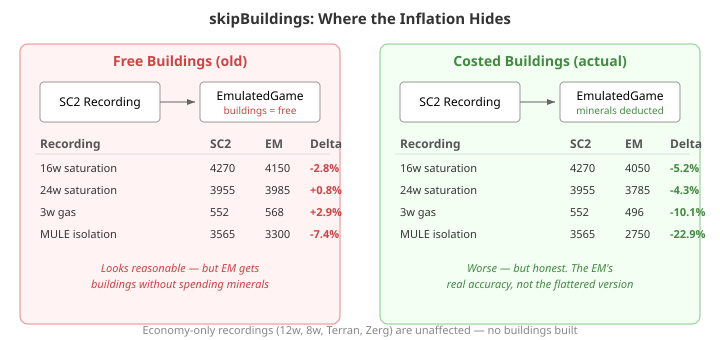

# When Your Tests Pass but Your Numbers Lie

The emulated game had good numbers. 12-worker Protoss mineral income: -0.3% vs SC2. 24-worker saturation: +0.8%. 16-worker oversaturation: -2.8%. All within the range where you nod and move on.

Then we built a catalogue of every calibration recording — a table of all SC2 baselines, their EM counterparts, and the deltas. The kind of infrastructure that feels like busywork until it catches something.

It caught something.

## The dual-run framework

The idea is simple: record a game in real SC2, capture a per-tick snapshot of minerals, vespene, units, and buildings. Then run the same playbook against the emulated game and compare tick by tick. Any divergence in unit counts triggers an early exit — the economy comparison only matters if the structural state matches.

There are fourteen single-run recordings now, covering mineral baselines at three saturations (8, 12, 16, 24 workers), three races, gas configurations, MULE income, expansion transfer, and worker trip timing. Each recording has a matching playbook that drives the EM through the same actions: train workers, build structures, assign gas workers, expand.

Some of these playbooks build structures — Pylons, Nexus, Supply Depots. The EM can't place buildings at real SC2 map positions (it doesn't model map geometry for placement), so the test framework uses `skipBuildings`: buildings get created instantly at a dummy position via `debugCreateBuilding()`. The building appears, supply is added, and the test continues.

The problem is what `debugCreateBuilding` doesn't do. It doesn't deduct minerals.

## Free buildings

A Pylon costs 100 minerals. A Nexus costs 400. A Supply Depot costs 100. When the test framework skips building placement, it was also skipping the bill. Every playbook that built structures was giving the EM free minerals that SC2 spent.

Those free minerals didn't sit idle. With continuous worker training (`train: PROBE, loop: continuous`), every unspent mineral goes into the next worker, which mines more minerals, which trains more workers. The inflation compounds.

The 24-worker saturation playbook builds a Nexus (400) and several Pylons. That's 800+ free minerals cascading through continuous training. The 16-worker playbook builds fewer structures — less inflation. The MULE isolation playbook builds three Supply Depots and a Barracks: 550 minerals not being deducted.

This is why the numbers looked good. They weren't.

## What the catalogue revealed

Economy-only recordings — 12w Protoss, 8w Protoss, Terran, Zerg — don't build anything. Their numbers are real. The 12w baseline at -0.3% is genuine accuracy.

But every recording that uses `skipBuildings` was flattered. When we added mineral cost deduction as an option and re-ran:

The 24w result flipped from +0.8% (EM slightly over SC2) to -4.3% (EM significantly under). The MULE isolation delta tripled from -7.4% to -22.9%. The 3w gas comparison — which looked like a comfortable +2.9% — dropped to -10.1%.

The EM's true accuracy is worse than the catalogue showed. The test framework was hiding the gap.

## Why this was invisible

Each test passed. The structural checks (unit counts, building counts, upgrades) were clean. The economy deltas were within ranges that felt plausible. Without a catalogue comparing recordings side-by-side, there was no signal that the skipBuildings tests were systematically optimistic while the economy-only tests were not.

The pattern only becomes visible in aggregate: every recording that builds structures shows a better delta than every recording that doesn't. That's not noise — it's a systematic bias. But you can't see a systematic bias by looking at one test at a time.

## The interim fix

The first response was cautious: make cost deduction opt-in (`deductBuildingCosts` parameter) rather than changing the default, because the existing calibration was done against the free-building baseline. That parameter let us see the honest numbers without breaking existing test assertions.

We also filled the four remaining gaps in the catalogue: Zerg mineral baseline (+0.3%), MULE isolation (-7.4% with the original free-building numbers), worker speed (-1.1%), and expansion transfer — which turned out to be structurally incomparable because instant construction gives supply too early, snowballing 30+ extra workers by tick 304.

The expansion transfer gap led to the deeper finding: `skipBuildings` doesn't just skip costs, it skips construction time. Supply from a Nexus arrives immediately instead of 71 seconds later. For economy-only comparisons, that doesn't matter. For multi-base economy with continuous training, it distorts everything.

## Eliminating the bypass

The temptation was to layer another parameter — `delayConstruction` — on top of the existing `skipBuildings` flag. That would have been a fake delay bolted onto a fake building, pretending to model physics without actually modelling it.

The EM already has real building physics. `EmulatedGame.handleBuild()` deducts resources, creates the building as incomplete, schedules a `PendingCompletion` with `SC2Data.buildTimeInLoops()`, and only grants supply when the building actually finishes. This is the same path that replay-driven games, live SC2 games, and the standard playbook runner all use.

The calibration test framework was the only code path bypassing it. The fix was to stop bypassing it.

The `skipBuildings` branch — which called `debugCreateBuilding()` for instant creation — was replaced with `game.applyIntent(BuildIntent.of(...))`, routing through the same `handleBuild` pipeline everything else uses. The `deductBuildingCosts` parameter became unnecessary because `handleBuild` deducts costs as part of its normal operation. The `skipBuildings` guard on building comparison in the `compare()` method was removed — buildings are always compared now, with tolerance for construction timing differences.

Three details mattered in the transition. First, the calibrate loop needs to check mineral availability before applying the intent, because `handleBuild` silently returns on insufficient resources — if the step gets marked as fired without the building being placed, it never retries. Second, gas buildings need geyser positions from the baseline for correct worker assignment, while other buildings can go at a fixed offset. Third, the fixed offset must match what the standard playbook handler uses (30, 30) — a different position changes the worker-pause calculation, which shifts mining income, which causes self-baseline tests to diverge against themselves.

The result is a net reduction of 19 lines. The 5-overload `calibrate()` chain collapsed to 2 overloads. The expansion-transfer tolerance dropped from 50 to 5. All 3,375 tests pass.

## What infrastructure catches that tests don't

A passing test tells you the code does what the test expects. A calibration catalogue tells you whether your expectations are consistent with each other. The free-buildings bug wasn't in the simulation physics — the physics runs fine. It was in the test harness, inflating results for a subset of recordings. No single test could detect it because no single test was wrong. The pattern across recordings was wrong.

The catalogue is a table in a markdown file. The recordings are JSON snapshots. The dual-run framework is a 200-line test method. None of this is sophisticated. But the combination — a systematic, browsable comparison of every calibration point — made a bias visible that had been hiding in plain sight across months of work.

The deeper lesson is about workaround gravity. `skipBuildings` started as a reasonable shortcut: "the EM can't do map-aware placement, so skip it." Then it needed `deductBuildingCosts` to handle the mineral gap it created. Then it needed construction-time delay to handle the supply gap. Each patch made the bypass more complex, more fragile, and harder to remove — while the real physics pipeline sat unused, already doing everything correctly. The right fix was always the simplest one: stop bypassing the system that already worked.
