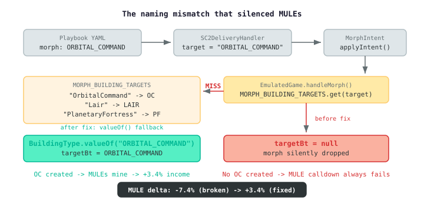

# The Morph That Never Happened

The emulated game's MULE income was -7.4% below SC2. That was the number in the calibration catalogue, sitting there with a footnote: "EM lacks MULE calldown — SCV-only income." A known gap, tolerated with a unit count tolerance of 3 in the dual-run test.

Except the MULE calldown was implemented. The code was there — `TerranRaceModel.onCalldown()` spawns the unit, `handleAbility()` deducts energy, `tickPassive()` applies income and handles expiry. Working tests proved it. Two integration tests exercised MULE calldown with spawned Orbital Commands, asserting MULE count and energy deduction. All green.

So why did the calibration playbook produce zero MULEs across 305 ticks?

## Four layers of indirection

The playbook path goes: YAML step (`morph: ORBITAL_COMMAND`) to `SC2DeliveryHandler.doMorph()` to `EmulatedGame.applyIntent(MorphIntent)` to `handleMorph()`. That last method looks up the target name in a static map called `MORPH_BUILDING_TARGETS`.

The map:

```java
Map.of(
    "OrbitalCommand", BuildingType.ORBITAL_COMMAND,
    "Lair",            BuildingType.LAIR,
    "Hive",            BuildingType.HIVE,
    ...
)
```

The playbook sends `"ORBITAL_COMMAND"`. The map has `"OrbitalCommand"`. The lookup returns null. The morph is silently dropped — no exception, no log at warn level, no return value anyone checks. The Orbital Command is never created. Every subsequent MULE calldown attempt resolves zero OC buildings and returns false. The playbook's `loop: continuous` fires the calldown every tick for 305 ticks, and every single one silently fails.



## Two naming worlds

The map uses SC2's internal API names — CamelCase identifiers like `OrbitalCommand`, `PlanetaryFortress`, `GreaterSpire`. These come from replay events and the SC2 protocol. The playbook uses Java enum names — `ORBITAL_COMMAND`, `PLANETARY_FORTRESS` — because that is the natural format when defining game actions in YAML against a Java codebase.

Both naming conventions are valid. Neither is wrong. The problem is that nothing bridges them.

The fix is three lines in each of the two lookup sites — `EmulatedGame.handleMorph()` and `SC2DeliveryHandler.doMorph()`:

```java
BuildingType targetBt = MORPH_BUILDING_TARGETS.get(m.targetName());
if (targetBt == null) {
    try { targetBt = BuildingType.valueOf(m.targetName()); }
    catch (IllegalArgumentException ignored) {}
}
```

The CamelCase map handles replay-driven morphs. The `valueOf()` fallback handles enum-style names from playbooks and tests. Both paths converge on the same `BuildingType`, and the rest of the method doesn't care which found it.

## What the fix revealed

With MULEs actually mining, the MULE isolation playbook went from 3300 minerals (SCV-only) to 3686 minerals. SC2 produces 3565. The delta flipped from -7.4% to +3.4%.

The slight over-production is structural: the EM applies MULE income as a flat rate per tick — 277.8 minerals per minute, calibrated empirically from oracle replays. Real SC2 MULEs mine in trips: walk to patch, harvest, walk back, deposit. The flat model skips the walk overhead and delivers income uniformly. At 3.4% over, the calibration is in the right range, and fixing the trip-based model is a separate piece of work.

## The tolerance that hid the bug

The dual-run calibration test for MULE isolation ran with `unitTolerance=3` and a comment explaining why:

```java
// unitTolerance=3: EM doesn't create MULE units from calldown
```

This is the most honest version of a workaround — clearly labelled, clearly temporary. But it still hid the bug. The test passed. The numbers looked reasonable (SCV-only income at the right scale). Nobody went looking for the missing OC because the test said everything was fine.

Tolerances are necessary in simulation work. SC2's tick-level randomness means exact matches are rare. But a tolerance that exists specifically to mask a known gap is a promise to investigate later — and "later" only arrives when something forces you to look at every entry in the catalogue side by side.

That is what a calibration catalogue does. Not make the numbers better. Make the gaps visible.
