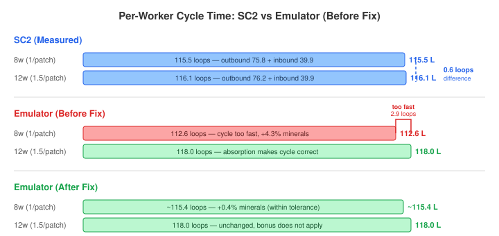

# Every Worker Gets the Same Clock

The emulator's 8-worker economy was running 4.3% hot. Eight Probes on eight patches, zero contention, no queueing — and yet the emulator produced a hundred more minerals than SC2 over 304 ticks. The 12-worker case was fine: -0.3%, essentially perfect. So the natural assumption was that something about zero contention made the emulator's cycles too short.

That assumption was wrong in a way I didn't expect.

## The measurement that changed the model

I extracted per-worker phase timing from SC2 cadence recordings at both 8w and 12w. Each worker's cycle splits into two halves: outbound (walk to patch + approach animation + mining) and inbound (walk to base + deposit). Measure both halves at different saturation levels and you should see the effect of contention.

Here's what SC2 actually does:

| Saturation | Outbound | Inbound | Full cycle |
|---|---|---|---|
| 8w (1 worker/patch) | 75.8 loops | 39.9 loops | 115.5 loops |
| 12w (1.5 workers/patch) | 76.2 loops | 39.9 loops | 116.1 loops |

The difference is 0.6 loops. Per-worker cycle time is effectively constant regardless of whether there's one worker per patch or one and a half. The inbound half is identical to a tenth of a loop. The outbound half differs by less than half a loop.

SC2 workers don't slow down when crowded. They don't speed up when alone. Every worker gets the same clock.



## Why the emulator got it wrong

The emulator's approach docking mechanism was designed to absorb waiting time. When a worker arrives at an occupied patch, it waits for the previous miner to finish. The approach docking — the time the worker spends positioning and aligning before mining begins — was reduced by however long the worker had already waited. The floor was 20 loops (the pure animation component), and the base docking was about 25 loops.

At 12 workers on 8 patches, some patches have two workers. The second worker waits, the approach docking absorbs the wait, and the cycle ends up around 118 loops — close enough to SC2's 116. The absorption mechanism worked.

At 8 workers on 8 patches, nobody waits. Every worker gets the full 25-loop approach docking with no absorption. And 25 loops turned out to be about 3 loops too short. The cycle ran at 112.6 loops instead of SC2's 115.5.

The mechanism was doing two things at once: modelling the approach animation (correct) and compensating for waiting overhead (also correct at 12w). But it created a saturation-dependent cycle time that SC2 doesn't have. The 12w case looked right because the absorption masked the too-short base cycle. The 8w case exposed it.

## The fix

The approach is straightforward once you see the invariant. At low saturation — when the base has at most one worker per non-depleted patch — add a small bonus to the approach docking. This models the SC2 behaviour: at zero contention, workers have unconstrained maneuvering room and their approach paths are less direct. No queueing pressure to streamline entry.

```java
private double effectiveApproachDocking(MineralPatch patch, int baseIndex) {
    double docking = patch.approachDockingLoops;
    int workers = countMineralWorkersAtBase(baseIndex);
    int activePatchCount = 0;
    for (MineralPatch p : bases.get(baseIndex).patches())
        if (!p.isDepleted()) activePatchCount++;
    if (activePatchCount > 0 && workers <= activePatchCount)
        docking += LOW_SATURATION_APPROACH_BONUS;  // 4.5 loops
    return docking;
}
```

At higher saturation, the bonus doesn't apply. The existing waiting-time absorption already extends cycles correctly at 12w and above.

The result: 8w drops from +4.3% to +0.4%. 12w stays at -0.3%. All other saturation levels unchanged — 16w, 24w, every playbook calibration test passes without regression.

## What it teaches

The conventional mental model of RTS mining economies treats worker throughput as inversely proportional to contention. More workers per patch means more waiting, which means lower per-worker output. That's true for the total base throughput curve — it does flatten. But the mechanism isn't that individual workers slow down.

SC2's implementation is cleverer. Per-worker cycle time stays constant. Total throughput scales linearly with worker count until patch saturation caps it. The saturation curve isn't about individual workers getting worse — it's about the gap between cycles: at 1 worker per patch, only one cycle runs per patch. At 1.5, the second worker's cycle overlaps the first, adding throughput proportional to the overlap fraction, not by squeezing the existing worker.

This matters for any simulation that needs to model an economy at different scales. If your per-entity throughput varies with density, you'll get the aggregate curve right at the density you calibrated against and wrong everywhere else. If per-entity throughput is constant, one calibration point fixes all of them.
