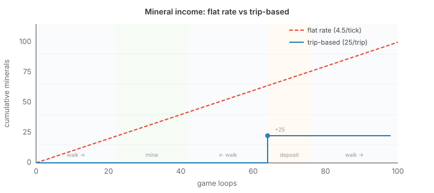

# MULEs Don't Get a Flat Rate

The MULE income model was a single number: 277.8 minerals per minute, spread uniformly across every game tick. Calibrated from 115 oracle replay observations. Empirically correct at the aggregate level.

The number was right. The model was wrong.

## What a flat rate hides

A MULE in SC2 doesn't generate income continuously. It walks to a mineral patch, drills into it, harvests 25 minerals, walks back to the town hall, deposits, and repeats. Each trip has walk time — both directions — plus a mining animation, plus a deposit delay. The walk time depends on how far the OC is from the nearest patch. The mining animation is longer than a worker's. None of this is captured by a flat rate.

The flat rate produced +3.4% over-production against the SC2 baseline in a MULE isolation playbook. Not catastrophic, but the error is structural: it can never respond to patch distance, base layout, or the natural gaps between trip deliveries.

The flat line spreads income uniformly. The step function shows what actually happens: nothing during the walk, 25 minerals on delivery, nothing during the return. The flat rate overpays during walks and underpays during harvests. At aggregate scale the numbers can look right while the per-tick distribution is wrong.

## Reusing what already works

The emulated game already has trip-based mining for regular workers. `WorkerSimulation` models each worker individually — acceleration, deceleration, patch contention, deposit delays, the full per-loop physics. Rather than building a parallel simulation for MULEs, we added them into the same system.

MULEs live in a separate map from workers. Same `SimulatedWorker` class, same movement physics, same `moveOneLoop()` per-loop stepping. But different rules: MULEs don't claim mineral patches (they mine independently of workers), don't participate in collision resolution, don't get reassigned to gas, and carry 25 minerals per trip instead of 5.

The separation matters. Regular workers participate in patch contention, rebalancing across bases, gas building assignment, and builder pauses. MULEs do none of this. Putting them in the same map would mean adding `if (mule)` guards to every worker management method. A separate map means the existing worker code doesn't know MULEs exist.

## Calibration by mechanism

The first attempt used 30 minerals per trip and no approach animation. Result: +12.3%. Way too fast — MULEs were completing too many trips per lifetime.

Switching to 25 minerals (the Liquipedia consensus value) and adding the same 20-loop approach animation that workers use brought it to +6.3%. Closer, but MULEs in SC2 have a visibly longer drilling animation than worker mining. Adding a 20-loop mining overhead — calibrated against the SC2 baseline — landed at +1.4%.

Three constants, each grounded in mechanism: cargo matches the game's per-trip delivery, approach animation matches the visual docking behaviour, and mining overhead captures the MULE's distinctive drilling cadence. The income falls out of the physics. No aggregate rate formula needed.

## The pattern holds

This is the fourth time the same lesson has landed in the emulated game. Train times: replace a formula with actual game loops. Mineral income: replace a saturation curve with per-worker trip simulation. Gas income: replace a queue with concurrent building entry. MULE income: replace a flat rate with trip-based mining.

Each time the formula was empirically calibrated and the numbers looked plausible. Each time the mechanism was different from the formula's assumptions. Each time replacing the formula with the mechanism improved accuracy without needing to recalibrate when surrounding conditions changed.

A flat rate can't tell you what happens when a MULE spawns at a distant expansion. Trip-based mining can — the walk is longer, the trips are fewer, the income is lower. The mechanism is the model.
