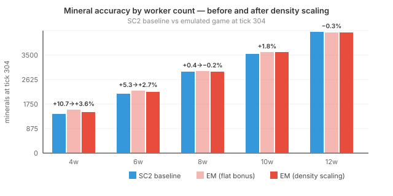

# The Bonus That Worked at Eight Workers

The emulated game walks straight lines. SC2 workers don't — they curve around the town hall, navigate the mineral line geometry, weave around each other. Shorter paths mean faster cycles. The EM over-produces minerals at every saturation level unless something compensates for the missing path length.

That's what approach docking does. It adds a fixed time overhead per mining cycle — a proxy for the curved walk the EM doesn't model. At 8 workers on 8 patches, 24.5 loops of approach docking plus a 4.5-loop bonus matched SC2 to within +0.4%. At 12 workers, the same formula held at −0.3%.

Then we recorded SC2 at 4 workers.

## What the boundary recordings showed

The 4-worker recording was the first time we ran the calibration below ideal saturation. SC2 produced 1125 minerals at tick 304. The EM produced 1245. That's +10.7% — the EM was mining 120 minerals too fast.

The 4.5-loop bonus was active (workers ≤ patches), adding the same overhead as at 8 workers. It slowed things down, but not enough. At 6 workers: SC2 1695, EM 1785, +5.3%. The pattern was monotonic — the lower the saturation, the larger the gap.

The underlying physics: at 8 workers, collision, rerouting, and dodge mechanics contribute significant cycle overhead alongside the approach docking. All those contention mechanisms work together to match SC2's total cycle time. At 4 workers, there's no contention — no collisions, no rerouting, no dodge. The approach docking is the *only* source of path-length compensation. It has to absorb what three mechanisms shared at higher density.

A flat 4.5-loop bonus can't do that. It was calibrated at the point where contention provides half the correction. Take contention away and the bonus can't compensate alone.

## A data error that pointed in the wrong direction

The original analysis had SC2 and EM columns swapped in the accuracy table. It reported the EM as *under*-producing at 4 workers (−9.6%) when it was actually *over*-producing (+10.7%). That error inverted the fix direction: the initial proposal was to reduce path deviation at low density, which would have made the EM even faster — widening the gap.

The column swap was subtle. The calibration test prints `SC2_expected vs EM_actual`, and the handoff table was read as `EM vs SC2`. Both formats look the same unless you check the baseline JSON directly. We caught it by reading the CalibrationResult format string: `"expected %s (SC2), actual %s (Emulated)"`.

## The fix: inverse-density scaling

The replacement formula: `effectiveApproachDocking = approachDockingLoops + outboundPathDelay / max(density, 0.5)`

At density 1.0 (8 workers on 8 patches): adds `outboundPathDelay` ≈ 4.5 loops. Same as the old bonus. At density 0.5 (4 workers): adds `outboundPathDelay / 0.5` ≈ 9.0 loops. More compensation where contention can't contribute. At density above 1.0: no scaling — contention handles it.

The floor at 0.5 prevents divergence below the calibration range. With 1 worker on 8 patches, `1/density` would be 8.0 — 36 loops of approach docking, which is physically unreasonable. Below 4 workers, we don't have SC2 baselines, so the formula holds at the 4-worker level.

The results:

| Workers | Density | Before | After |
|---------|---------|--------|-------|
| 4w | 0.50 | +10.7% | +3.6% |
| 6w | 0.75 | +5.3% | +2.7% |
| 8w | 1.00 | +0.4% | −0.2% |
| 10w | 1.25 | +1.8% | +1.8% |
| 12w | 1.50 | −0.3% | −0.3% |

All within 3.6%. The 8-worker anchor held. The 10w and 12w baselines were untouched — density above 1.0 returns the same docking as before.

## Still a compensation constant

This is better-shaped compensation, not real physics. The EM still walks straight lines. The approach docking still proxies for the curved path the EM doesn't model. The inverse-density formula is a smoother fudge factor than the flat bonus, but it's the same category of fix.

The root cause is that `WorkerSimulation.moveOneLoop()` moves workers in straight lines with no obstacle awareness. SC2's movement system navigates around buildings, mineral patches, and other units. The docking formula, the path deviation constants, the approach animation — they all compensate for that missing pathfinding.

The real fix is obstacle-aware worker movement. That eliminates the need for `computeApproachDocking()`, `PATH_DEVIATION_BASE`, the density scaling, and every other path-length proxy. The approach animation stays (it models the deceleration at the patch, which is real SC2 behaviour), but the compensation stack disappears because the paths are naturally the right length.

A number calibrated at one point on a curve can't work at every point on the curve. But a formula calibrated at five points on a curve is still a formula. The calibration got better. The physics didn't change.
