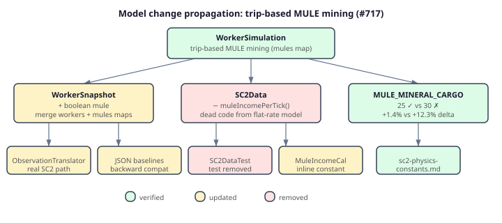

# The Other Half of a Model Change

Replacing the flat-rate MULE income model with trip-based mining was last week's work. The income now falls out of physics — walk time, drilling animation, 25 minerals per trip, repeat until expiry. The delta dropped from +3.4% to +1.4% against the SC2 baseline. That was the visible part.

The invisible part is everything downstream of a model change that doesn't break the build.

## MULEs were invisible

When MULEs moved from a flat income formula into `WorkerSimulation`, they landed in a separate `mules` map. Workers live in `workers`. The `workerSnapshots()` method — the API that exposes detailed per-worker state (position, task, cargo, patch assignment) — only iterated `workers`. MULEs had full physics simulation but zero observability through the snapshot API.

This matters because `WorkerSnapshot` is the bridge between simulation state and anything that wants to visualise or analyse individual worker behaviour. The workbench, the cadence baselines, the cycle decomposition diagnostics — all consume `workerSnapshots()`. If MULEs aren't in that list, they're ghosts: they affect the mineral count but nobody can see why.

The fix adds a `boolean mule` field to `WorkerSnapshot` and merges both maps into the output stream. The `ObservationTranslator` — the real SC2 path — detects MULEs via unit type. Existing JSON calibration baselines deserialise correctly because Jackson defaults a missing boolean to `false`. Five files, sixty lines. The kind of change that's trivial to implement and easy to forget exists.

## Dead code that compiles

The old `muleIncomePerTick()` method in `SC2Data` was empirically calibrated from 115 oracle replay observations. It returned the right number. After the trip-based model replaced it, no production code called it any more. Two test references kept it alive: a trivial positivity assertion in `SC2DataTest` and two comparison print statements in a diagnostic calibration test.

Dead code that compiles is worse than dead code that doesn't. A method with zero callers but passing tests looks maintained. Someone reading `SC2Data` for the first time would see `muleIncomePerTick()` right next to `MULE_MINERAL_CARGO` and reasonably conclude both are current. The flat rate was 277.8 minerals per minute. The trip-based model produces roughly the same aggregate but through a completely different mechanism. Having both side by side invites the wrong mental model.

## Verifying the number you inherited

The `MULE_MINERAL_CARGO = 25.0` constant arrived from Liquipedia. It was used because 25 gave a better calibration fit than 30, which had been the first attempt. But "better fit" is a relative claim. The question is whether 25 is empirically correct or just empirically less wrong than 30.

The verification is straightforward. A `WorkerSimulation` with one base, one MULE, no workers, running for a full MULE lifetime. Every deposit is recorded. If the cargo is 25, every deposit should be exactly 25 minerals — no fractions, no rounding artifacts, no compensation.

Thirteen trips. Each one exactly 25.0 minerals. 325 minerals total per MULE lifetime, which is consistent with the SC2 baseline delta of +1.4% (the residual comes from walk time and mining overhead differences, not cargo). With cargo=30, the same playbook produces +12.3% — far outside calibration tolerance.

The interesting thing isn't the number. It's that the number was never individually verified. It was inherited from Liquipedia, adopted because it improved the aggregate fit, and treated as correct because nothing broke. That's how most constants in a simulation end up: validated by integration, never by isolation.

## The pattern

Changing a model is half the work. The other half is propagating that change through every API surface that assumed the old model's shape. `workerSnapshots()` assumed MULEs didn't exist. `SC2DataTest` assumed the flat-rate method was current. The physics constants doc cited "Direct match" when the evidence supported a stronger claim.

None of these would have surfaced as failures. The build passes. The tests pass. The deltas look good. The propagation failures are all correctness-invisible: an API that returns incomplete data, dead code that misleads readers, documentation that understates its own evidence. The kind of things you only find by deliberately looking after the model change has landed.

The next piece of this is the low-saturation approach bonus — a compensation constant that adds overhead when it should subtract it. That's the remaining model issue the trip-based migration exposed. The MULE cleanup had to land first because it touches the same worker simulation infrastructure.
