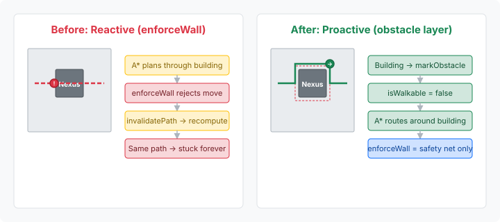

# The Pathfinder That Couldn't See Buildings

The [previous entry](2026-11-20-mdp01-rectangles-not-radii.md) gave buildings their correct rectangular footprints. `enforceWall()` now checks axis-aligned rectangles instead of circles, and `SC2Data.buildingFootprint()` returns tile dimensions for every building type. Buildings have the right shape.

But the pathfinder didn't know they existed.

`AStarPathfinder` plans army unit routes by querying `TerrainGrid.isWalkable()` — which checks terrain height (walls, ramps, ground) and the obstacle layer (reference-counted `int[][]` cells). Buildings weren't in either. A Stalker told to cross the map would compute a straight-line path through a Nexus, hit `enforceWall()`'s post-move rejection, have its path invalidated, recompute — and walk straight into the Nexus again. The cycle repeated every tick. The pathfinder was blind to obstacles that the physics layer could see.



The infrastructure to fix this was already in place. Worker pathfinding had landed obstacle-aware A* routing a few days earlier — mineral patches registered as circular obstacles on the shared `TerrainGrid`, and workers computed waypoint paths around them. The same `markRectangularObstacle()` / `clearRectangularObstacle()` API, the same reference-counted grid, the same `AStarPathfinder` that army units already used for terrain walls. The gap was wiring: no building lifecycle method called the obstacle API.

The fix is two methods on `EmulatedGame`:

```java
void registerBuildingObstacle(Building bldg) {
    if (terrainGrid == null) return;
    int[] fp = SC2Data.buildingFootprint(bldg.type());
    terrainGrid.markRectangularObstacle(
        (float) bldg.position().x(), (float) bldg.position().y(),
        fp[0] / 2.0f, fp[1] / 2.0f);
    movementStrategy.invalidateAllPaths();
}
```

Every building lifecycle method — `handleBuild`, `handleBuildingBorn`, `handleBuildingDied`, the replay injection methods, the test helpers — calls one of these two. Buildings register from placement start, not completion. SC2 blocks pathing the moment construction begins, and so does the EM now. `enforceWall()` stays as a safety net, but A* does the real routing.

The interesting design question was `invalidateAllPaths()`. When a building appears or disappears, every army unit's cached path might now be invalid — it could route through the tile that just changed. The choice was between invalidating all paths (simple, O(n) A* recomputes) and filtering to only paths that geometrically intersect the changed footprint (precise, but adds intersection-testing code). At 20-50 army units on a 64x64 grid, a full A* recompute takes under a millisecond. Building events happen maybe once every 30 seconds. The simple approach is correct and the overhead is invisible.

The same pattern extended to vespene geysers. Geysers are 3x3 tile obstacles in SC2 — solid enough to block pathing even before a Refinery or Assimilator is built on top. One call to `markRectangularObstacle` in `setGeyserResources()` and army units route around them. Mineral patches were already handled — worker pathfinding had registered them on the shared grid, and army A* inherits the same obstacle layer.

The relationship between `enforceWall()` and the obstacle layer is worth naming explicitly. Before this change, `enforceWall()` was the _primary_ building collision mechanism: it iterated every building, every unit, every tick. Now it's a _secondary_ safety net — the obstacle layer tells A* where buildings are, so paths never cross them in the first place. The per-tick iteration still runs, but it almost never triggers. The architectural shift is from reactive (reject bad moves after they happen) to proactive (plan good routes before they start). The same shift that happened for workers with mineral patches now applies to army units with buildings and resources.s.
