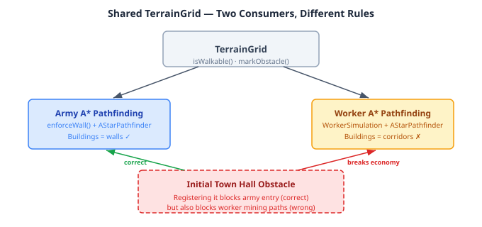

# The Obstacle With Two Faces

The [previous entry](2026-11-22-mdp01-pathfinder-that-couldnt-see-buildings.md) added the obstacle layer — buildings and geysers registered on the terrain grid so A* routes army units around them. `enforceWall()` remained as a safety net: a per-tick iteration over every unit × every building, checking for footprint entry. With the obstacle layer active, `enforceWall` almost never triggers. The terrain's `isWalkable` check catches everything first.

The optimisation looked obvious. Buildings are on the grid. The grid check runs first. Skip the building iteration.

## Three Attempts, Three Failures

**Attempt 1: skip the iteration entirely when the terrain grid is active.** Two tests broke. The initial town hall — the Nexus placed during `reset()` — was never registered as a terrain obstacle. It existed only in the building list. Skip the building iteration and enemy units walk straight through it. No collision check at all.

**Attempt 2: register the initial town hall as an obstacle too.** Register every building in `reset()`, then skip the iteration safely. Eight tests broke. Workers spawned inside the Nexus couldn't move. The terrain check is blunt — if the proposed tile is unwalkable, the move is rejected. It doesn't distinguish entry from exit. Workers start on unwalkable tiles and are trapped.

**Attempt 3: make the terrain check entry-only.** Only block movement from a walkable tile to an unwalkable tile. Units already on unwalkable tiles (spawned inside the building) can move out. All the movement tests passed. But the MULE economy isolation test regressed: 1.1% delta jumped to 4.6%.

The root cause was not in `enforceWall`. It was in the terrain grid itself.

## The Shared Grid Problem

The terrain grid serves two consumers. Army A* pathfinding uses it to route combat units around buildings. Worker A* pathfinding uses it to route workers between mineral patches and the town hall. Both read `isWalkable()`. Both respect obstacles.



Registering the initial Nexus as a 5×5 obstacle blocks tiles between the base and the mineral line. Army units correctly route around it. But workers also route around it — adding walk distance to every mining trip. The MULE test measures economy accuracy against an SC2 baseline. Longer walks mean less income. The 4.6% gap was the cost of workers taking the scenic route home.

In SC2, workers walk through their own buildings. Buildings are walls for army units but corridors for workers. The grid can't express both rules at once.

## The Fix: Skip What's Registered

The initial town hall can't be registered as an obstacle — it breaks worker economy. Mid-game buildings can and should be registered — workers don't walk through a Factory placed in the middle of the map.

The distinction: registered buildings (mid-game) are on the terrain grid and covered by the `isWalkable` check. Unregistered buildings (initial town hall) are not on the grid and need the entry-only footprint check.

```java
for (var bldg : friendly.buildings()) {
    if (terrainGrid != null
            && !terrainGrid.isWalkable(
                    (int) bldg.position().x(),
                    (int) bldg.position().y())) {
        continue; // covered by terrain check
    }
    // entry-only footprint check for unregistered buildings
    if (!insideFootprint(current, bldg)
            && insideFootprint(proposed, bldg)) {
        movementStrategy.invalidatePath(unitTag);
        return current;
    }
}
```

If the building's center tile is unwalkable, it's registered — skip it. If the center tile is walkable, it's the initial town hall — check the footprint. The iteration drops from O(units × all_buildings) to O(units × initial_buildings), which is typically 1-2 buildings instead of 10+.

## The Design Principle

A shared resource that serves consumers with different access rules will eventually enforce the wrong rule on the wrong consumer. The terrain grid looked like a single responsibility — "which tiles are walkable." But walkability has two definitions here: army-walkable (buildings block) and worker-walkable (buildings don't block). Merging them into one grid means every obstacle implicitly applies to both consumers.

The general form: when you register state that multiple systems consume, check whether "registered" means the same thing to each consumer. If it doesn't, the registration is a side effect for one of them.

We got lucky in one sense — the economy tests caught this immediately. The MULE isolation test acts as a canary for worker pathing changes. Without it, the regression would have been invisible until someone noticed the dual-run calibration drifting.
