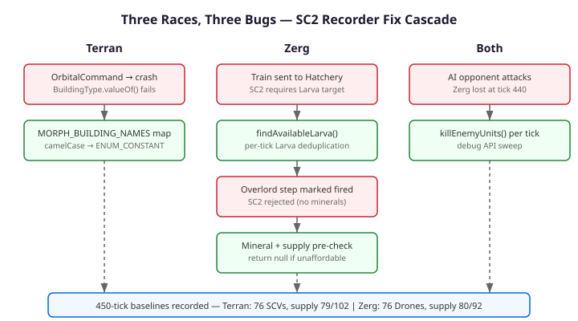

# Three Races, Three Bugs

The Protoss two-base economy playbook has been calibrated against SC2 for weeks. Terran and Zerg hadn't been touched — the recorder had only ever driven Protoss games. Each race we added broke the recorder in a different way, and fixing each bug revealed the next one.

## The morph name crash

Terran was first. The playbook ran fine against EmulatedGame — SCVs trained, Supply Depots built, CC expanded. The SC2 recording crashed at tick 104 with `No enum constant io.quarkmind.domain.BuildingType.OrbitalCommand`. The morph step uses camelCase (`morph: OrbitalCommand`) because that's the SC2 API convention. The `SC2DeliveryHandler` handles this through a lookup map. The recorder was calling `BuildingType.valueOf()` directly — which expects `ORBITAL_COMMAND`.

The fix was a five-entry map mirroring the delivery handler's. OrbitalCommand, PlanetaryFortress, Lair, Hive, GreaterSpire. The kind of bug that only surfaces when a second race exercises a code path that was always there but never reached.

## Zerg: everything is Larva

Zerg broke at a deeper level. The recorder drove SC2 for the full 450 ticks but produced a baseline with 12 Drones from start to finish. Supply stuck at 14/14. No Overlords, no expansion.

The problem: Zerg training in SC2 goes through Larva, not through the Hatchery. `translateTrain` was sending `TRAIN_DRONE` to the Hatchery tag — the same approach that works for Protoss and Terran, where the production building receives the command. SC2 ignored it silently.

The fix targeted Larva instead, with per-tick tracking to prevent two training commands from hitting the same Larva in one game loop. But even with correct targeting, the economy didn't grow. Supply stayed at 14/14.

The diagnostic logging told the story. At tick 1, the Overlord step fired — Larva targeted, command sent. At tick 2, the same Larva reappeared. SC2 had rejected the command. Starting minerals are 50, the first Drone costs 50, and the Overlord costs 100. At tick 1, there's about 5 minerals in the bank. SC2 rejects the train, but the recorder marks the step as `fired` — a one-shot step that consumed its single chance and never retries.

The mineral pre-check was the last piece: return null from `translateTrain` when the player can't afford the unit. The step stays unfired, retries next tick, and eventually succeeds when minerals accumulate.

## The enemy nobody wanted

Both races shared one more problem. The recorder creates a game against a Very Easy AI. For Protoss, the AI never attacks within 450 ticks. For Zerg, the AI arrived around tick 440 and killed everything. The Terran game survived but the economy was disrupted.

The debug API has full control in single-player games. A per-tick sweep that kills all enemy units made the recordings clean — no combat, pure economy.

## What the baselines show

Both races produced healthy economies once the recorder worked:

| Race | Workers | Overlords | Supply | Gas buildings |
|------|---------|-----------|--------|---------------|
| Terran | 76 SCVs | — | 79/102 | 2 Refineries |
| Zerg | 76 Drones | 10 | 80/92 | 2 Extractors |

The pinned calibration — replaying SC2's exact build order through the EM tick by tick — revealed that the dominant divergence isn't mining physics. It's worker distribution. SC2's debug API creates expansion buildings instantly but doesn't auto-transfer workers. The SC2 baseline has all workers on one base. The EM auto-transfers workers across bases, distributing them evenly.

The result is counterintuitive: the Terran EM over-produces minerals (+36%) because two-base mining is more efficient per worker than oversaturated single-base mining. The Zerg EM under-produces (-46%) for the same structural reason — the split just lands differently.

The economy model itself is accurate enough. The gap is in the test harness, not the simulation.
