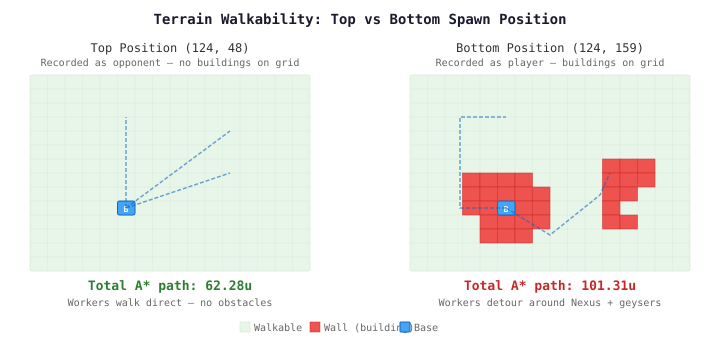

# The One-Sided Map

The emulated game's mineral accuracy had a position problem. Run the same 12-worker economy playbook at the top spawn position on TorchesAIE: +1.8% error. Run it at the bottom: +4.0%. Same playbook, same patch geometry, same distances — different results.

The mineral patches at both positions are rotationally symmetric. Eight patches each, identical distances from the base (6.0u to 7.6u), identical amounts (four 1500, four 750). I confirmed this by extracting patch positions from the SC2 baselines and measuring centre-to-centre distances. The geometry was not the culprit.

## The walkability dump

The A* pathfinder was the next suspect. I computed paths from each base to its eight local patches and compared total path lengths. Top position: 62.28 tile-units. Bottom position: 101.31. A 62.7% difference.

That's not a rounding error. Something was fundamentally wrong with the terrain around one of the bases.



Dumping the walkability grid around both bases made the problem obvious. The top base sat in a completely clear 20×20 area — not a single wall tile. The bottom base had a 5×5 Nexus footprint, two geyser footprints, and scattered mineral patch obstacles. Workers at the top could walk in straight lines. Workers at the bottom had to path around their own town hall.

## Fog of war in the pathing grid

The terrain grid is captured from SC2's `ResponseGameInfo.startRaw.pathingGrid` at game start. This grid includes the player's own starting buildings — Nexus, mineral patches, geysers — as wall tiles. But the opponent's buildings are hidden by fog of war and absent from the grid.

The terrain was recorded from a game where the player spawned at the bottom. The bottom base's buildings became wall tiles; the top base was clear. When the emulated game used this terrain for calibration at the top position, workers walked through where their Nexus should have been.

## The fix

`EmulatedGame.reset()` creates the starting Nexus via `seedInitialState()`, then registers it with the worker simulation for mineral patch assignment. But it never called `registerBuildingObstacle()` — the method that marks the building's footprint as unwalkable on the terrain grid. Buildings created during gameplay got obstacle registration; initial buildings did not.

One line:

```java
for (Building b : friendly.buildings()) {
    registerBuildingObstacle(b);  // added
    if (playerRaceModel.townHallTypes().contains(b.type()) && b.isComplete()) {
        registerTownHallWithPatches(b.tag(), b.position());
    }
}
```

The position variance dropped from 3.3% to 1.0%. The 10-worker bottom-position baseline went from +4.0% error to +0.3%.

## What remains

The residual 1.0% comes from mineral patch and geyser obstacles that are still baked into the terrain grid at the bottom position but absent at the top. The terrain grid's static wall tiles include everything visible to the recording player — not just the Nexus. The fix addresses building footprints dynamically; mineral patch obstacles are a separate layer.

The gas accuracy also shifted — correctly. Workers now path around the Nexus to reach geysers, which makes gas cycles longer. The emulated game was already underproducing gas due to a walk-model distance-dependent error, and the longer paths made it worse. The gas accuracy regression is real SC2 behaviour, not a bug — it just exposes a deeper issue with how the walk model handles distances above 7 units.

Three calibration items shipped in this session: the gas docking re-sweep (which found that the docking constant is correct and the gap is in the walk model), the position-dependent fix described here, and a Zerg playbook update that adds Queen training with the SPAWNING_POOL tech prerequisite that was missing. The Zerg baseline was re-recorded from real SC2 with Queens appearing by tick 180.
